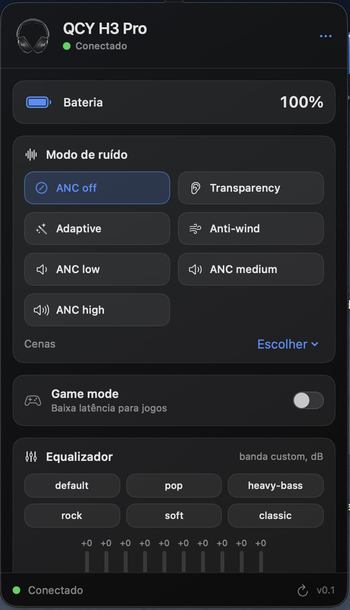

# QCY H3 Control (app de barra de menus para macOS)

App nativo de **barra de menus** para controlar o headset **QCY H3 / H3 Pro**
pelo protocolo proprietário **JieLi RCSP** sobre **Bluetooth Low Energy (BLE)**,
sem o app oficial da QCY.

- **Stack**: Swift 6 + SwiftUI + AppKit + CoreBluetooth.
- **UI**: `NSStatusItem` + `NSPanel` borderless com seta apontando para o ícone
  (mesma abordagem do [LGwebOS-menubar](https://github.com/gabrielgreco1/LGwebOS-menubar)),
  tema escuro, cards e scroll único.
- **Build**: Swift Package Manager (sem `.xcodeproj`), empacotado como `.app`.
- **Requer**: macOS 14 ou superior.

> **Não-oficial.** O protocolo JieLi RCSP foi documentado pela comunidade para o
> H3 / H3 Pro. Use por sua conta e risco.

## Preview



## Recursos

- **Conexão automática** com o canal de controle BLE (`QCY H3 Pro-APP`, service `a002`),
  com reconexão quando cai.
- **Bateria** no card de status do painel.
- **ANC**: off, transparency, low/medium/high, adaptive, anti-wind e as cenas
  commuting/indoor.
- **Game mode** (baixa latência).
- **Equalizador de 10 bandas**: presets (default, pop, heavy-bass, rock, soft,
  classic) e editor com 10 sliders verticais para a banda custom (-12 a +12 dB).
- **Monitor** opcional de bateria (a cada 15s).
- **Visual**: painel escuro no estilo do LGwebOS-menubar, com a foto do fone no
  header e ícone próprio do app.

## Como compilar e rodar

```bash
cd ~/Desktop/Projetos/qcy-menubar
./build.sh            # compila (release) e monta "QCY H3 Control.app"
open "QCY H3 Control.app"
```

Para desenvolvimento, dá pra rodar direto pelo SPM:

```bash
swift run
```

Na primeira execução o macOS pede **permissão de Bluetooth**. Se não aparecer,
libere em **Ajustes do Sistema > Privacidade e Segurança > Bluetooth**.

O app é um *agente* (`LSUIElement`), então não aparece no Dock nem no Cmd+Tab.
Para sair, use o botão **Sair** no painel.

## Como usar

1. Ligue o fone e deixe-o por perto.
2. Pronto: o app **conecta sozinho** quando encontra o canal `QCY H3 Pro-APP`,
   e reconecta se a conexão cair.
3. Ajuste ANC, game mode e o equalizador pelo painel.

A conexão é **automática** por design. Dá para desligar no menu "..." do painel
(nesse caso aparece um botão "Conectar agora"). O app guarda o identificador BLE
do último fone para reconectar em menos de um segundo; enquanto não acha, mostra
"Procurando o fone...".

## Notas de protocolo

Pacote RCSP: `FE DC BA | flag | opCode | len(2B BE) | [status] | sn | [xmOp] | params | EF`

- Serviço GATT `0000a002-...`, Write `00000001-...`, Notify `00000002-...`.
- Handshake obrigatório ao conectar: `NOTIFY_COMMUNICATION_WAY` (op 11), params `00 00`.
- ANC: opCode `0xFF`, params `17 03 <sub> <group> <level>`.
- EQ: opCode `0xFF`, params `22 <len> <preset> 70 FE <10×7 bytes>`.
- Game mode: opCode `0xC0`, params `02 05 <01|02>`.
- Bateria: opCode `0xC1`, máscara `1<<0`, resposta TLV.

No macOS o CoreBluetooth não expõe o MAC; usamos o `peripheral.identifier` (UUID
por-host) e o nome `QCY H3 Pro-APP`.

## Testado

Validado com o **QCY H3 Pro** rodando no macOS: conexão automática, bateria,
ANC (leitura e escrita), game mode e equalizador (leitura e escrita).

## Limitações conhecidas

- O canal `-APP` só aparece quando o fone está ligado e por perto. Se o app não
  achar o fone, reconecte o headset e tente de novo.
- Sem controle de ENC do microfone (não existe no firmware/protocolo do H3 Pro).
- Não há comando de **desligar** por software nesse protocolo; o que existe é
  **reiniciar** o dispositivo (opcode `0xE7`). Para desligar, use o botão do fone.

## Diagnóstico

O executável dentro do `.app` aceita flags (o app é um agente, então não há Dock):

```bash
BIN="./QCY H3 Control.app/Contents/MacOS/QCYMenubar"
"$BIN" --help                        # ajuda
"$BIN" --background                  # inicia sem abrir o painel
"$BIN" --diagnose                    # conecta pelo mesmo stack BLE e imprime o estado
"$BIN" --diagnose --write-test       # + re-aplica ANC/game/EQ (sem mudar nada)
```

O `--diagnose` é a forma de testar a pilha BLE sem clicar em nada. O log do app
fica em `~/Library/Application Support/QCYMenubar/log.txt`.

## Estrutura

```
qcy-menubar/
├── Package.swift
├── build.sh                     # compila + monta o .app + assinatura ad-hoc
├── Support/Info.plist           # LSUIElement, NSBluetoothAlwaysUsageDescription
├── Resources/                   # Headset.png (header) + AppIcon.icns
└── Sources/QCYMenubar/
    ├── main.swift               # entrada: flags (--help/--diagnose/--background)
    ├── AppDelegate.swift        # NSStatusItem + NSPanel + posicionamento
    ├── RCSP.swift               # framing, opCodes, tabelas ANC/EQ
    ├── HeadsetModel.swift       # estado + CoreBluetooth + comandos
    ├── Diagnostics.swift        # modo --diagnose (headless)
    ├── Theme.swift              # cores, cards, seta do painel
    └── Views/
        ├── QCYPanel.swift       # conteúdo do painel (cards, EQ)
        └── Components.swift     # slider vertical + indicador de status
```

